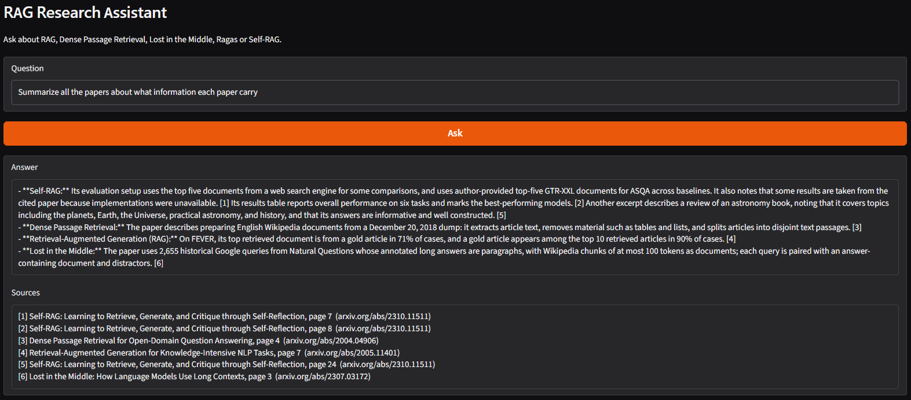

# RAG Research Assistant


A question-answering assistant over five research papers about retrieval and RAG. I first built a version of this in 2024, alongside my [Telecare RAG chatbot](https://github.com/TitusDV/telecare-rag-chatbot), using an older model. This repo is a 2026 rebuild: cleaner code, tests, a reviewed question set and a current model.

The papers:

| arXiv | Paper |
|---|---|
| 2005.11401 | Retrieval-Augmented Generation for Knowledge-Intensive NLP Tasks |
| 2004.04906 | Dense Passage Retrieval for Open-Domain Question Answering |
| 2307.03172 | Lost in the Middle: How Language Models Use Long Contexts |
| 2309.15217 | Ragas: Automated Evaluation of Retrieval Augmented Generation |
| 2310.11511 | Self-RAG: Learning to Retrieve, Generate, and Critique through Self-Reflection |

The PDFs are downloaded from arXiv when you run it. They are not in the repo because arXiv's licence doesn't allow redistributing them.

## How I tested retrieval

Every page of every paper is labelled with its arXiv id and page number, and those labels stay with the chunks after splitting. I then needed questions where I knew which page had the answer. A model (gpt-6-luna) read sampled pages and wrote one question per page, along with an exact quote from the page as evidence. If the quote wasn't really on the page, the question was thrown out.

The questions still needed checking. A lot of them were bad in ways I didn't expect: questions about citations in the reference list, about which table shows what, about trivia inside worked examples, or about the paper's main claim, which appears on several pages so there is no single right answer. I reviewed the first batch by hand, then wrote an LLM judge that follows the same rules. It agreed with my decisions on 94% of 36 questions (`eval/judge_check.md`), so I let it review the second batch.

Each retriever (BM25, dense embeddings, and a hybrid of the two) was run on whole pages and on 1000, 500 and 250 character chunks. A result counts as correct if it comes from the question's page. Scoring by page instead of by chunk means the answer key doesn't change when the chunk size does.

## Results

36 questions, top 10 results per retriever. Full table in `eval/results.md`.

| Retriever | Chunk size | Hit@1 | Hit@5 | MRR@10 |
|---|---|---|---|---|
| BM25 | whole page | 0.72 | 0.92 | 0.788 |
| BM25 | 1000 | 0.69 | 0.97 | 0.788 |
| Hybrid | 250 | 0.69 | 0.89 | 0.768 |
| Dense | 250 | 0.61 | 0.81 | 0.688 |
| Dense | whole page | 0.22 | 0.53 | 0.359 |

What I took from it:

- With the first 19 questions, hybrid at 250 characters looked like the clear winner. With 36 it's tied with BM25. One question moves hit@1 by about 0.03, so small gaps here don't mean much.
- Dense retrieval on whole pages was poor, and it got much better as chunks got smaller. The embedding model (all-MiniLM-L6-v2) only reads the first 256 tokens of its input, so on a full page most of the text is never embedded.
- BM25 probably does better here than it would with real users, because the generated questions tend to reuse the page's own wording.

## Asking questions

`python app.py` opens a small web app. The assistant uses hybrid retrieval on 500 character chunks: the results above put it level with BM25, and I expect real users to word things differently from the papers, which is where the dense half helps. It answers only from the passages it retrieves, cites them by paper and page, and says "The papers don't cover this." when they don't.



## Running it

```bash
pip install -r requirements.txt
python scripts/download_papers.py
python -m pytest

cp .env.example .env                    
python scripts/make_questions.py       
python scripts/review_questions.py     
python scripts/auto_review.py --check  
python scripts/auto_review.py          
python scripts/run_eval.py             
python app.py                          
```

## Code

```
src/research_rag/
  papers.py       the five papers (you can add more and of your own interest)
  chunking.py     loading and chunking with paper and page labels
  retrievers.py   BM25, dense and hybrid
  questions.py    question generation, evidence check, reference-page filter
  review.py       the LLM judge
  evaluate.py     the comparison
  answer.py       answering with citations
  metrics.py      hit rate and MRR
  llm.py          OpenAI or Ollama model
app.py            the web app
scripts/          the commands
eval/             the questions, results and judge check
tests/
```
